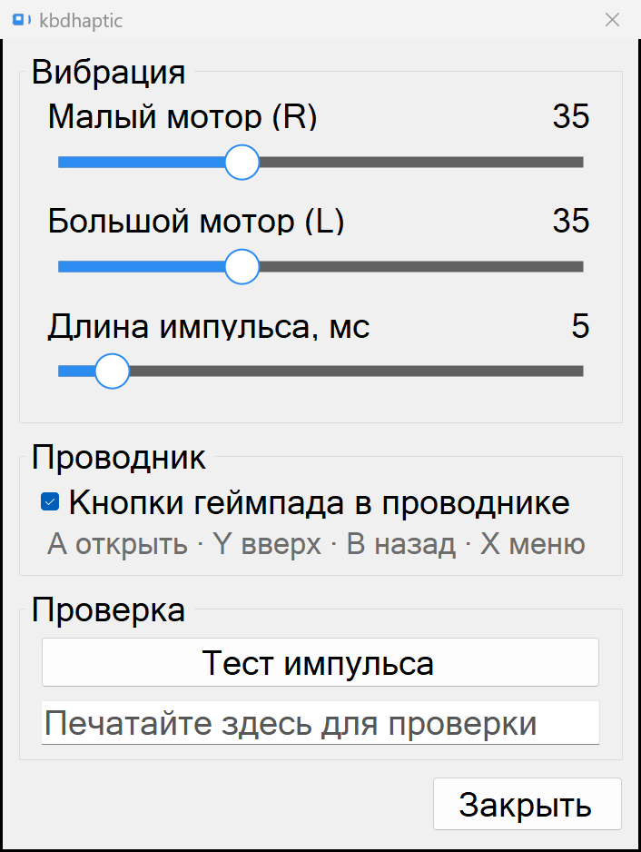

# kbdhaptic

Виброотклик экранной клавиатуры и управление проводником с геймпада для портативных
ПК на Windows 11 (собрано и проверено на MSI Claw 8 AI+).

- **Вибро на набор:** короткий виброимпульс контроллера на каждый тап по клавише
  экранной клавиатуры. Вне клавиатуры (рабочий стол, игры, прокрутка) тишина.
- **Набор геймпадом:** поддерживается раскладка сенсорной клавиатуры "Игровая
  приставка", виброотклик срабатывает и при наборе текста геймпадом.
- **Геймпад в проводнике:** пока активно окно проводника, геймпад управляет им
  (каждое действие с вибрацией): **A** открыть, **Y** уровень вверх, **B** назад,
  **X** контекстное меню.
- Работает в фоне из трея, без прав администратора, в простое около 0% CPU.

## Как работает

Низкоуровневый хук клавиатуры ловит инжектированные нажатия экранной клавиатуры. Пока
клавиатура видима (`IFrameworkInputPane`), каждый тап даёт виброимпульс XInput (мотор
выключается по таймеру). Действия в проводнике опрашивают XInput только когда окно
проводника активно. Детект по области и видимости клавиатуры, а не по отдельным клавишам.

Проверено на хендхелде с Intel Arc (Lunar Lake). Нужен XInput контроллер (слот 0) и
.NET Framework 4.x (есть в Windows по умолчанию).

## Установка

Скачай папку `release` (или архив релиза) и запусти **Install.cmd**. Он удалит прошлую
версию, установит в `%LOCALAPPDATA%\kbdhaptic`, повесит автозапуск по входу в систему
(без прав администратора) и запустит. **Uninstall.cmd** всё удаляет. Настройки в
`kbdhaptic.ini` сохраняются при обновлении.

## Настройки

Двойной клик по иконке в трее:

- **Вибрация:** Малый мотор (R) и Большой мотор (L), длина импульса (1-40 мс), кнопка
  Тест и поле для проверки ввода.
- **Проводник:** переключатель "Кнопки геймпада в проводнике".

Все настройки лежат в `kbdhaptic.ini` рядом с программой и применяются сразу.

## Сборка

Запусти **build.cmd** (использует встроенный в .NET Framework компилятор C#, Visual
Studio не нужен). Результат в `release/kbdhaptic.exe`.
